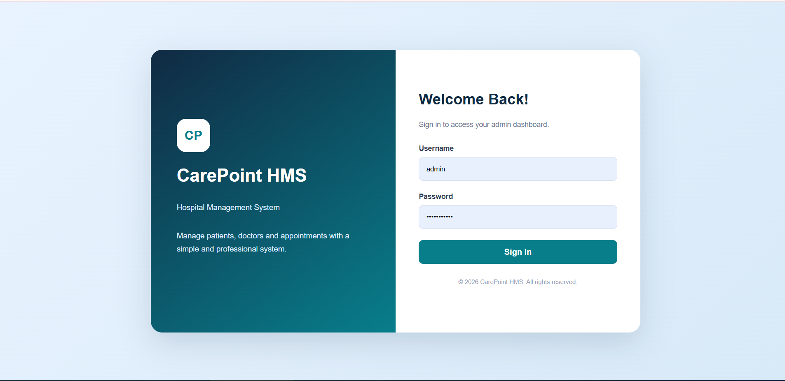
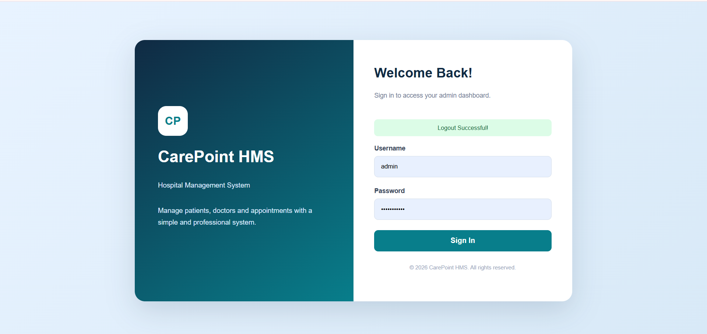
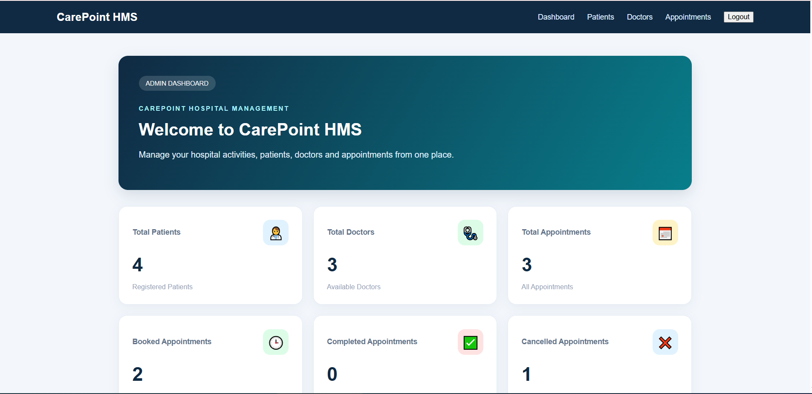
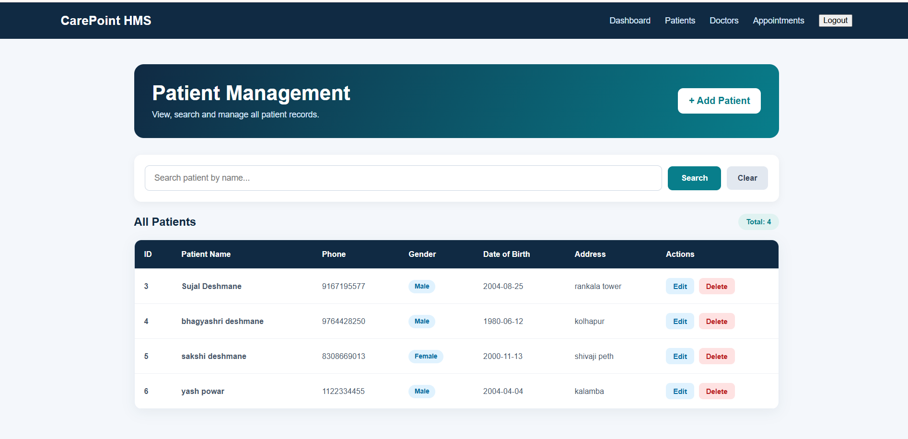
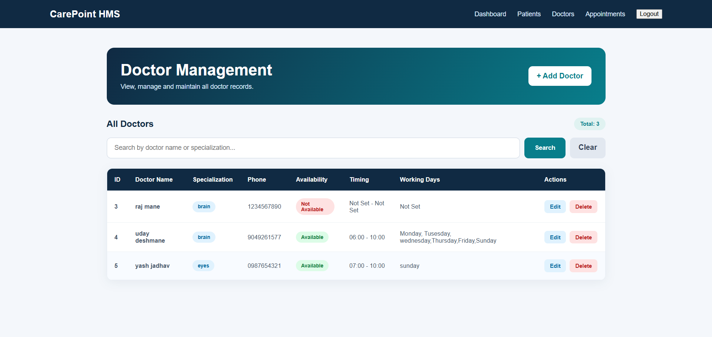
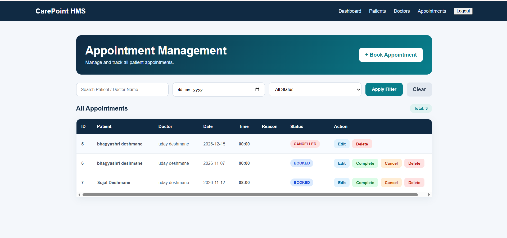

# CarePoint - Hospital Management System

A full-stack web-based Hospital Management System developed using Java, Spring Boot, Thymeleaf and MySQL.

## About the Project

CarePoint is a web application designed to simplify hospital management activities. It helps manage patient records, doctor information and appointments through an admin dashboard.

## Technologies Used

- Java 17
- Spring Boot 3.5.7
- Spring MVC
- Spring Data JPA
- Hibernate
- Thymeleaf
- HTML, CSS, JavaScript
- MySQL
- Spring Security
- Maven
- Chart.js

## Features

### Patient Management
- Add new patients
- View patient records
- Edit patient details
- Delete patient records
- Search patients by name

### Doctor Management
- Add new doctors
- View doctor records
- Edit and delete doctor details
- Search by doctor name or specialization
- Manage doctor availability
- Configure working hours and working days

### Appointment Management
- Book appointments
- View, edit and delete appointments
- Search and filter appointments
- Complete or cancel appointments
- Validate doctor availability
- Validate working hours and working days
- Prevent past-date appointments
- Prevent duplicate booked appointments for the same doctor, date and time

### Admin Dashboard
- Patient, doctor and appointment counts
- Booked, completed and cancelled appointment counts
- Appointment status chart
- Upcoming appointments list

### Authentication
- Admin login using Spring Security
- Protected application pages
- Logout functionality

## Screenshots

### Login Page


### Logout Page


### Admin Dashboard


### Patients Page


### Doctors Page


### Appointments Page


## Requirements

- Java 17 or newer
- MySQL Server
- Apache Maven
- VS Code or IntelliJ IDEA

## Setup and Installation

1. Clone or download this repository.
2. Open the project folder in VS Code.
3. Start MySQL Server.
4. Open `src/main/resources/application.properties`.
5. Configure your MySQL database name and username.
6. Set the `DB_PASSWORD` environment variable to your MySQL password.
7. Open the terminal in the project folder.
8. Run the application:

```bash
mvn spring-boot:run
```

9. Open your browser:

```text
http://localhost:8080
```

## Demo Admin Login

The current demo configuration uses in-memory authentication.

- Username: `admin`
- Password: `Admin@12345`

Note: Change the demo credentials before using the application outside a local demo environment.

## Author

**Sujal Deshmane**

MSc Computer Science Student

## Project Purpose

This project was developed as a practical learning project to understand full-stack web development using Java, Spring Boot, MySQL and related technologies.
